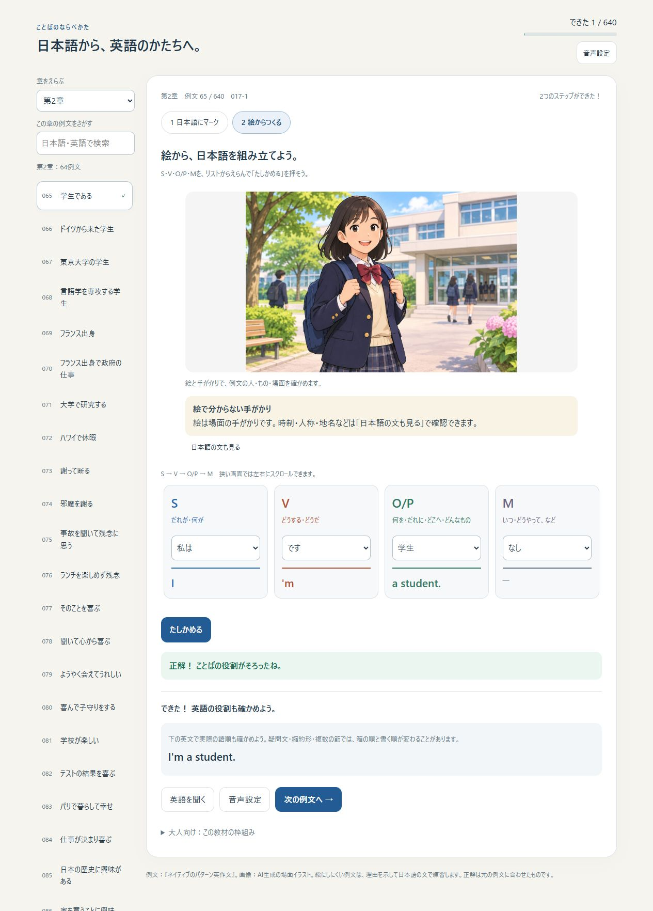

# ことばのならべかた：新教材の試作

[公開版を開く](https://thousandsofties.github.io/EnglishStructureLearning/) · [時制の絵くらべ（40問）](https://thousandsofties.github.io/EnglishStructureLearning/#tense-pictures)

main へのプッシュごとに GitHub Actions が教材を再生成し、テスト成功後に GitHub Pages を更新します。

現在の [`index.html`](index.html) は、身近なオリジナル例文938文を使う新教材版です。ブラウザーで直接開けます。データと操作部分は埋め込み済みで、サーバーは不要です。

初めて開くと、レベル1の絵付き918文を使う「絵を見てえらぶ」で始まります。絵を見て主語・述語などを選びます。「カードを並べる」に切り替えて練習することもできます。絵や文章の両側にある矢印で、前後の場面へ移動できます。

- レベル1：主語 ＋ 述語 ＋ 対象１ ＋ 対象２ ＋ 場所 ＋ 時の六つの欄。日本語カードをドラッグして欄に置きます。マウス・タッチの両方に対応し、カードを押してから欄を押す方法でも使えます。使わない欄は空欄で正解です。
- 動作や状態の舞台は［場所］に入れます。述語が表す意味を補う行き先や置き先などは［対象１］・［対象２］に入れます。
- 左上の「☰」で例文メニューを開きます。「レベル」は複数選べます。「レベル1の文」はレベル1の例文だけを絞り込みます。
- 同じ場面の「基本・今・過去」は、例文一覧から順に選べます。例文を選ぶとメニューが閉じます。
- レベル2・3：絵を見て日本語を選ぶ方法と、日本語のカードを並べる方法を切り替えられます。助動詞や疑問詞も日本語で選び、英語で話す順に組み立てます。正解後は完成英文と各欄の対訳を確認でき、元の文と比べられます。
- 入力欄の下にある「チェックする」で答えを確認します。正解すると短い音が鳴り、完成英文と各欄の対訳が現れます。アメリカ英語の声を選び、「はやく読む」「普通に話す」「ゆっくり読む」で英文を聞けます。対訳カードを押すと、その部分だけを直前に選んだ速さで聞けます。右上の「初めに戻す」で、表示中の練習を最初からやり直せます。
- レベル1は「カードを並べる」と「絵を見てえらぶ」を切り替えられます。後者では「主語を選んでね」など、六つの欄のリストから日本語を選びます。使わない対象１・対象２・場所・時の欄は初期表示のままで正解です。絵の中に文字は入れず、曜日などは短いヒントで補います。完成した日本語文は表示しません。
- 置いたカードも別の欄へドラッグできます。元のカード置き場へドラッグすると戻ります。同じカードを2回押す方法でも戻せます。置けない場所で離すかEscキーを押すと、移動を取り消します。
- 進み具合は例文IDごとにブラウザーに保存します。旧640文版とは別の保存先です。音声設定は旧版と共有します。

[時制の絵くらべ](https://thousandsofties.github.io/EnglishStructureLearning/#tense-pictures)では10の動作を現在・過去・進行・経験の4形で練習できます。

元の基本300場面を中心に始め、比較例・代名詞・発展の再帰代名詞へ切り替えます。全件を最初から順に解く必要はありません。レベル1は918文、レベル2・3は各10文です。

**新教材アプリの再生成：**

```sh
python scripts/build_construction_app.py
node --test tests/construction.test.cjs tests/construction-app.test.cjs tests/progress.test.cjs
```

教材データと教材ドキュメントだけを更新するときは `python scripts/build_construction_examples.py` を使います。

画面の編集元は `src/construction-template.html` と `src/construction-practice.js` です。原稿は `data/original-curriculum.txt`、レベル2・3は `data/advanced-examples.json`、生成データは `data/construction-examples.json` にあります。

全938文にイラストが付いています。テーマ別の登録状況は [作画状況](docs/construction-artwork-status.md)、再開手順は [作業引き継ぎ](docs/work-continuation.md) を参照してください。画像は `assets/construction/`、対応表は `data/construction-illustrations.json`、生成に使ったプロンプトは `docs/illustration-prompts.json` に保存しています。`assets/tense/` のハイブリッド版は試作品で、最終承認済みのデザインではありません。自動派生した例文の自然さも引き続き確認が必要です。`.review-tmp/` は調査用で教材本体ではありません。

**注意：`scripts/build.py` は旧640文版で `index.html` を上書きします。新教材の生成に使わないでください。** 旧テンプレート・データ・582画像は残しています。`scripts/compile_original.py` も途中の旧4欄案です。

---

## 旧640文版の記録（以下は旧版専用）

子供が日本語と絵を使い、英語の大きな枠組みに慣れるための教材「ことばのならべかた」です。全10章・640例文を共通の画面で練習できます。

内蔵の画像生成で582例文を作画しています。画像化が難しい58例文も、日本語の文から同じ操作で練習できます。[例文別の作画指示と状況](data/illustrations.json) を保存しています。

## 使い方

[`index.html`](index.html) をブラウザーで開いてください。`assets` フォルダーと一緒に置くと、インストールやサーバーの起動なしで使えます。GitHubからはリポジトリ全体をダウンロードしてください。

1. 日本語のカードを S・V・O/P・M のエリアに運びます。
2. 絵を見ながら、各欄のリストから日本語を選びます。
3. 「たしかめる」で正解すると、それぞれの欄の真下に対応する英語を表示します。
4. 「英語を聞く」で英文を聞けます。「音声設定」では英語音声を選択・試聴・保存できます。
5. 章の選択と章内検索で例文を探せます。



進み具合と音声設定はブラウザー内に保存します。使える音声は端末・ブラウザーによって異なります。旧10例版の保存データは、同じ保存領域で開いた場合に引き継ぎます。

絵にしにくい抽象的な例文は、理由を示して日本語から組み立てる練習にします。作画の状況は `data/generation-status.json` と `data/illustrations.json` で確認できます。

詳しい操作は [使い方](docs/usage.md) を参照してください。

## この教材の枠組み

| 箱 | 見つけるもの |
| --- | --- |
| S | だれが・何が |
| V | どうする・どうだ |
| O/P | 何を・どこへ・だれに |
| M | いつ・どうやって、など |

O/P は、目的語や動作の相手・行き先、状態を説明する部分を大まかにまとめる教材用の箱です。正式な五文型の分類より、英語の文を組み立てる感覚をつかむことを目的としています。疑問文・縮約形・複数の節では、役割別の箱と実際に書く語順が異なるため、正確な英文も併記します。日本語と英語で主語や表現が変わる文には注記を付けています。

原著の本文とチャンク解説で表記が異なる箇所は、元の和文を保持したうえで練習用の表記を分けています。[修正理由](data/source-corrections.json) も保存しています。

## 編集と再生成

Python 3 の標準ライブラリーだけで生成できます。

```sh
python scripts/build.py
```

画像も埋め込んだ1ファイル版を作る場合：

```sh
python scripts/build.py --standalone ../EnglishStructureLearning-640.html
python scripts/validate_standalone.py ../EnglishStructureLearning-640.html
```

作画と検証には Pillow を使います。

```sh
python -m pip install -r requirements-authoring.txt
python scripts/validate.py
node --test tests/progress.test.cjs
```

作画途中の開発確認に限り、生成・検証コマンドに `--allow-pending` を付けられます。通常の生成・検証は未作画の例文が残っていると失敗します。

| ファイル | 内容 |
| --- | --- |
| `src/practice-template.html` | 画面・操作・音声設定の編集用ソース |
| `data/source.json` | 元の640例文と章・パターン・掲載ページ |
| `data/annotations/` | 個別に確認した文の区切り・役割・注記 |
| `data/japanese-frame-overrides.json` | 日本語の自然な役割と英語への組み替えが異なる文の設定 |
| `data/lessons.json` | 生成した640例文の日本語・英語・選択肢・役割 |
| `data/illustrations.json` | 例文別の作画プロンプトと作画状況 |
| `data/image-replacements.json` | 視覚確認後に差し替えた画像の対応表 |
| `data/image-review-summary.json` | 全582画像の確認記録と画像のハッシュ |
| `assets/images/` | 各例文のイラスト |
| `scripts/compile_lessons.py` | 注釈・補正・作画状況から共通の例文データを生成 |
| `scripts/build.py` | `index.html` または画像を埋め込んだ1ファイル版を生成 |
| `scripts/validate.py` | 原文保持・640文の網羅・選択肢・画像ファイルを検証 |
| `scripts/validate_standalone.py` | 1ファイル版の例文と埋め込み画像を検証 |
| `index.html` | ブラウザーで開く完成版 |

例文：『ネイティブのパターン英作文』全640例。場面イラスト：AI生成。

最初は「すべての章」で全640例文を表示します。章を選ぶと、その章の64例文に絞れます。表示件数と全体の件数も併記します。
