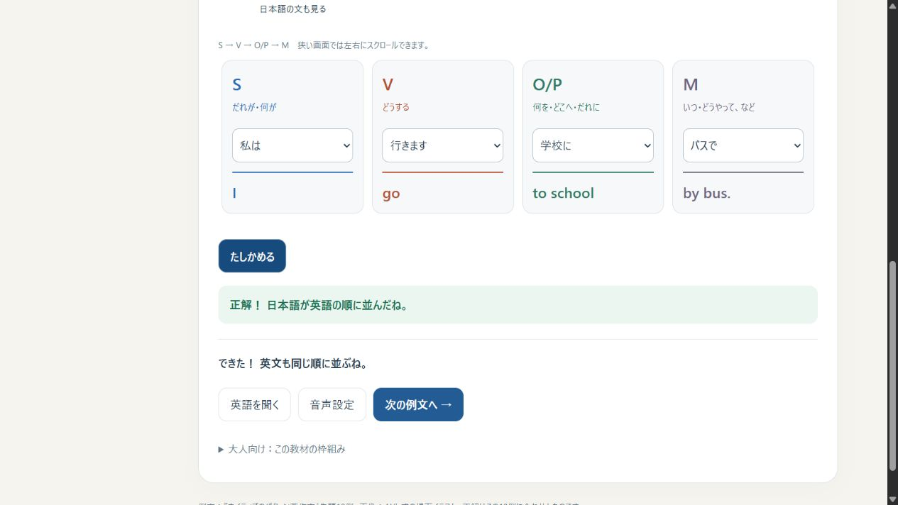

# EnglishStructureLearning

子供が日本語と絵を使い、英語の大きな枠組みに慣れるための教材「ことばのならべかた」です。まず10例文で練習できます。

## 使い方

[`index.html`](index.html) をブラウザーで開いてください。画像も含む1ファイルなので、コピーして別の端末でも使えます。インストールやサーバーの起動は不要です。

1. 日本語のカードを S・V・O/P・M のエリアに運びます。
2. 絵を見ながら、各欄のリストから日本語を選びます。
3. 「たしかめる」で正解すると、それぞれの欄の真下に対応する英語を表示します。
4. 「英語を聞く」で英文を聞けます。「音声設定」では英語音声を選択・試聴・保存できます。



進み具合と音声設定はブラウザー内に保存します。使える音声は端末・ブラウザーによって異なります。

詳しい操作は [使い方](docs/usage.md) を参照してください。

## この教材の枠組み

| 箱 | 見つけるもの |
| --- | --- |
| S | だれが・何が |
| V | どうする |
| O/P | 何を・どこへ・だれに |
| M | いつ・どうやって、など |

O/P は、目的語や動作の相手・行き先を大まかにまとめる教材用の箱です。正式な五文型の分類より、英語の文を組み立てる感覚をつかむことを目的としています。

## 編集と再生成

Python 3 の標準ライブラリーだけで生成できます。

```sh
python scripts/build.py
```

| ファイル | 内容 |
| --- | --- |
| `src/practice-template.html` | 画面・操作・音声設定の編集用ソース |
| `data/lessons.json` | 10例文の日本語・英語・選択肢・役割 |
| `assets/images/` | 各例文のイラスト |
| `scripts/build.py` | 例文と画像を埋め込み、`index.html` を生成 |
| `index.html` | ブラウザーで開く完成版 |

例文：『ネイティブのパターン英作文』先頭10例。場面イラスト：AI生成。
