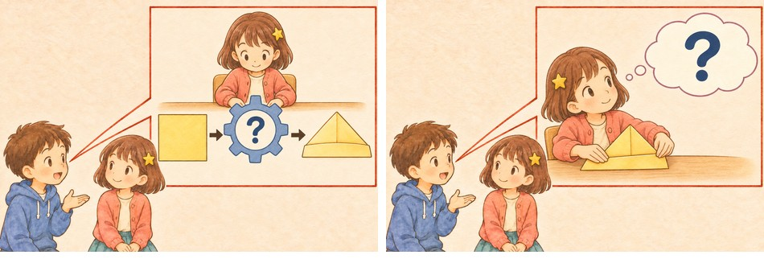
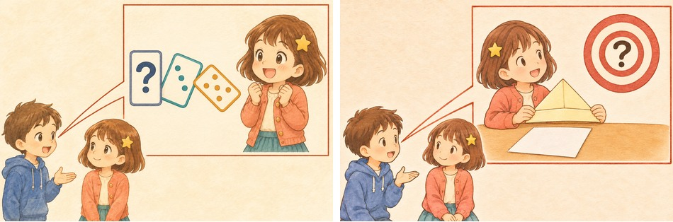

# How と Why の絵を見比べる

子どもが１枚の絵を見て、日本語のカードを選び、英語の質問を組み立てる教材です。まず下の２組を見て、それぞれの男の子が女の子に何と聞いているように見えるか、考えてみてください。

## ４枚で聞きたかったこと

| 絵 | 質問 | 絵の中の「？」 | 原寸PNG |
| --- | --- | --- | --- |
| 上段左 | How do you make a paper hat? | 紙から歯車へ、歯車から帽子へ矢印が伸びる。作り手の顔と材料と完成品が見えて、手元の歯車が折り方を隠す。 | [作り手と歯車](how-paper-hat-maker.png) |
| 上段右 | Why do you make a paper hat? | 帽子を折る手元は見せ、女の子が思い浮かべていることを空ける。 | [頭の上の吹き出し](why-paper-hat-thought.png) |
| 下段左 | Why are you happy? | 女の子が喜ぶきっかけを、最初のドミノの中に置く。 | [笑顔とドミノ](why-happy-domino.png) |
| 下段右 | Why do you make a paper hat? | 女の子が帽子を作る目的を、的の中心に置く。 | [帽子と的](why-paper-hat-target.png) |

## ここまでの感触

How は、作業する女の子と手元の歯車に手応えがありました。左右の矢印は、材料が作業に入り、完成品が出てくる関係を示します。角のある大きな吹き出しの先は男の子に向き、吹き出しの中の作り手は、外で話を聞いている女の子と髪飾り・服が一致します。

Why の思考の吹き出しには「何を考えているの？」という読み方もあります。ドミノは遊び、的は的当てに見えます。子どもが普段の経験から「どうしてそうなったの？」「何のためにするの？」と思える絵が、引き続き検討したい点です。

**パズルは文章で提案した段階です。** たとえば、帽子を折る場面に「誕生会でみんなが帽子をかぶる」ピースがはまると目的がわかります。喜んでいる場面に「欲しかったぬいぐるみをもらう」ピースがはまると理由がわかります。見本ではピースを半分はめ、練習ではピースの中を「？」にする案です。初見で「ここに何かが欠けている」から一歩進んで Why まで伝わるかは、まだ確かめていません。

## アプリで使っている絵

- レベル３の17問目は、紙・「？」入りの歯車・帽子が並ぶ構図です。上段左は、そこに作り手と矢印を描き加えた比較用の試作です。[公開版の How の絵](../../assets/construction/level3-17-method.png) ／ [最初の紙のぼうしの絵](../../assets/construction/level3-17.png)
- レベル３の15問目は、プレゼントを開けて喜ぶ女の子を見て、うれしい理由を聞く問題です。[公開版の Why の絵](../../assets/construction/level3-15.png)

## 時制の構図を比較した初期の試作

リポジトリを手元に保存すると、次のHTMLをブラウザーで開いて表示を切り替えられます。

- 掃除する場面の背景を表示・非表示にして、過去形・現在進行形・現在完了形を見比べます。[部屋の掃除と時間の流れ](tense/tense-illustration-proposal.html)
- 掃除中の部屋と片づいた部屋を並べて、説明を隠したときに絵で読み取れることを比べます。[掃除中の部屋と片づいた部屋](tense/tense-in-the-scene.html)
